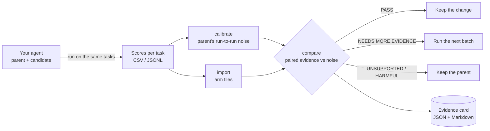

<div align="center">

# VERDICT

**Keep an agent change only when the evidence says so.**

[](https://github.com/TheOfficialBug/verdict-gate/actions/workflows/ci.yml)
[](https://pypi.org/project/verdict-gate/)
[](https://pypi.org/project/verdict-gate/)
[](LICENSE)
[](#research-status)

</div>

> **Research preview.** VERDICT is experimental decision support, not a proof that an agent is better, safe or
> production-ready. Its probability thresholds are policy rules, not guaranteed error rates. Use it next to domain
> review and staged rollout. See [Research status](#research-status).

You changed a prompt, a skill, a memory rule or a model, and the score went up. Is the change actually better, or did
you get a lucky run? Repeated runs of an **unchanged** LLM agent often disagree on a large share of tasks, so a single
higher score is weak evidence.

VERDICT answers one narrow question:

> Given paired, task-level results, is there enough evidence to keep this change?

It does not run or grade your agent. It reads the scores your evaluation already produces, measures how much the
unchanged agent varies, compares the change against that variation in small batches, and writes the decision into an
**evidence card** you can render, audit and replay.



## Install

```bash
pip install verdict-gate
```

Python 3.12+. Dependencies: NumPy, Pydantic, PyYAML, jsonschema, Typer. The import package is `verdict_gate`; the
command is `verdict-gate` (short alias `vgate`). No command makes a network call or needs an API key.

> Upgrading from 0.2? The import package and command were renamed from `verdict` to `verdict_gate` /
> `verdict-gate` to avoid a clash with an unrelated PyPI package. See [docs/migration.md](docs/migration.md).

## 60-second example

The bundled example has 60 synthetic support tickets: the parent run 3 times, a candidate run once.

```bash
verdict-gate example --out demo && cd demo
verdict-gate calibrate results.csv --revision parent --out floor.yaml
verdict-gate import results.csv --revision parent --max-tokens 256 --out parent.json
verdict-gate import results.csv --revision cand-1 --parent-id parent \
    --revision-file candidate_skill.md --max-tokens 256 --out candidate.json
verdict-gate compare --baseline parent.json --candidate candidate.json \
    --policy moderate --fnoise floor.yaml --out card.json
verdict-gate card render card.json
```

```console
UNSUPPORTED: futility rule met (n=8, Δ̂=+0.125, F=0.375, P(Δ>0)=1.000, P(Δ>F)=0.040, ...)
```

The candidate scored higher (0.767 vs 0.683), so "keep if higher" would keep it. VERDICT does not: the parent's own
repeats disagree on 42% of tickets, and the gain does not clear that noise. The example data is built so the candidate
is no better overall. Full walk-through: [examples/byot](examples/byot).

## Use it on your own tasks

1. **Write one row per task execution** (CSV or JSONL): `run_id, task_id, score, valid`, plus optional `seed`,
   `revision_id`, `model`, `cost_usd`, ... ([format](docs/user-guide.md#input-format)). Infrastructure failures are
   `valid=false`, never a score of 0.
2. **Run the parent at least twice** (3 to 5 is better) on the same tasks → `verdict-gate calibrate`.
3. **Run the candidate** on the same tasks → `verdict-gate import` both arms → `verdict-gate compare`.
4. **Save runs with batches:** `verdict-gate next-batch` says "stop" or names the next tasks to run in both arms.
5. **Check files** with `verdict-gate validate FILE` and **inspect a policy** with `verdict-gate policy moderate`.

| Command | What it does |
|---|---|
| `calibrate` | Noise floor F_noise(n) from ≥ 2 repeat runs of the parent |
| `import` | One arm file (one revision, one run per seed) from your results file |
| `compare` | One decision; the exit code is the decision |
| `next-batch` | Stop, or the next tasks to run (sequential evaluation) |
| `replay` | Recompute every decision from stored files (no network) |
| `card render` | One-page Markdown report of an evidence card |
| `validate` | Check a results file, arm file, floor file or card |
| `policy` | List the bundled policies or print one as applied |
| `example` | Write the example data |

## The five decisions

| Decision | Exit | Meaning | Do |
|---|---:|---|---|
| `PASS_GLOBAL` | 0 | The policy's admission rule is met overall; no configured subgroup is harmed | Consider keeping it, within the tested scope |
| `PASS_CONDITIONAL` | 10 | Supported only in some predeclared subgroups | Route only there; parent elsewhere |
| `NEEDS_MORE_EVIDENCE` | 20 | Not decided yet | Run the next batch |
| `UNSUPPORTED` | 30 | No gain beyond the noise floor (or the budget ran out) | Keep the parent |
| `HARMFUL` | 40 | Likely worse beyond the floor, or too costly without a demonstrated gain | Reject and investigate |

Exit 2 = invalid evidence (broken pairing, too many invalid executions, missing floor). Most CI systems treat any
non-zero exit as failure; read `card.json` if you need finer handling ([CI guide](docs/user-guide.md#ci)).

## What counts as a score

VERDICT is only as good as your score. In order of preference: automatic checks (tests pass, exact match, final
state); past human-approved answers as references; human ratings; an LLM judge **with** a reference answer.
**Do not use a reference-free LLM judge as the score**: in our tests one falsely accepted 41% of answers.

## Policies

| Policy | Purpose |
|---|---|
| `naive` | Keep-if-higher on one run. A comparison baseline, not a recommendation |
| `moderate` | Sequential paired comparison against the noise floor (default) |
| `strict` | Stronger evidence beyond the floor |
| `fixed_repeat` | Fixed number of repeats, no early stopping |
| `moderate_v4` | *Unreleased in 0.2.0.* `moderate` plus an evidence gate (no decision before 32 tasks and 6 disagreeing tasks; up to 120 tasks). Fixes a failure with near-deterministic agents ([methodology](docs/methodology.md#evidence-gate)) |

Your own policy is a YAML file. Version it, hash it, and do not change it after seeing candidate results.

## What the evidence shows so far

From the thesis experiments that built VERDICT (Qwen3.5-9B and Granite-4.2-8B agents; SealQA, FreshQA, FRAMES,
SimpleQA Verified, τ³ retail, DDXPlus, BANKING77, CLINC150, ToolBench). Every number has its denominator; details and
caveats in [docs/evidence.md](docs/evidence.md).

| Finding | Numbers | Status |
|---|---|---|
| Unchanged agents are noisy | 26.7% of answers flip between identical runs (SealQA, Qwen3.5-9B) | Measured |
| Fewer bad admissions | 6 candidates: keep-if-higher kept 5 (3 worse than the parent); VERDICT kept 1 (0 worse) | Pre-registered |
| Cheaper decisions | Same decisions as a fixed 3-seed design with 26 instead of 180 evaluations | Pre-registered |
| Self-improvement loop | 4 kept revisions instead of 17, $10.39 vs $39.55; held-out accuracy non-inferior at a 3-point margin on FreshQA (146 questions), inconclusive on H48 (48) | Pre-registered; non-inferiority post hoc |
| Across 34 stored comparisons | VERDICT made the fewest unsupported or harmful admissions (0.3 of 22) but missed most small real gains (8.4 of 12) | Post hoc benchmark |

The last row is the honest summary: **VERDICT is a cautious gate.** It rarely keeps a bad change and pays for that by
missing small improvements. Choose it where a wrong admission costs more than a missed one, for example in loops
where kept changes accumulate.

## Research status

**Established:** paired task-level evidence, a measured run-to-run floor, replayable evidence cards, invalid
executions kept separate from wrong answers, pre-registered thesis experiments.

**Not yet established** (and why the label is "research preview"):

- The posterior thresholds are policy rules. The false-admission and harmful-admission rates of the full sequential
  procedure (repeated looks, stopping, curtailment) have not been validated by simulation.
- The floor measures run-to-run noise on fixed tasks, not uncertainty from which tasks were sampled.
- With near-deterministic agents the floor is 0 and the Bayesian bootstrap can report P = 1.00 from a single
  disagreement; `moderate_v4` adds a minimum-evidence gate for this.
- Testing many candidates raises the chance of a false admission; there is no campaign-level error control yet.
- Subgroup routing must use strata fixed before seeing results, with held-out confirmation.

The roadmap for closing these is in [docs/methodology.md](docs/methodology.md#roadmap). Independent replication is
welcome.

## Documentation

- [User guide](docs/user-guide.md): input format, workflow, batching, CI, evidence cards
- [Methodology](docs/methodology.md): the statistics, the floor, the evidence gate, limitations, roadmap
- [Evidence](docs/evidence.md): thesis results with denominators and caveats
- [Migration from 0.2](docs/migration.md)
- [Changelog](CHANGELOG.md) · [Contributing](CONTRIBUTING.md) · [Security](SECURITY.md)

## Citation

```bibtex
@software{suresh2026verdict,
  author  = {Suresh, Kunal},
  title   = {{VERDICT}: Evidence-governed keep/reject decisions for changes to {LLM} agents},
  year    = {2026},
  url     = {https://github.com/TheOfficialBug/verdict-gate}
}
```

## License

Apache-2.0. Benchmark datasets keep their own licenses; this repository contains none of their data.
